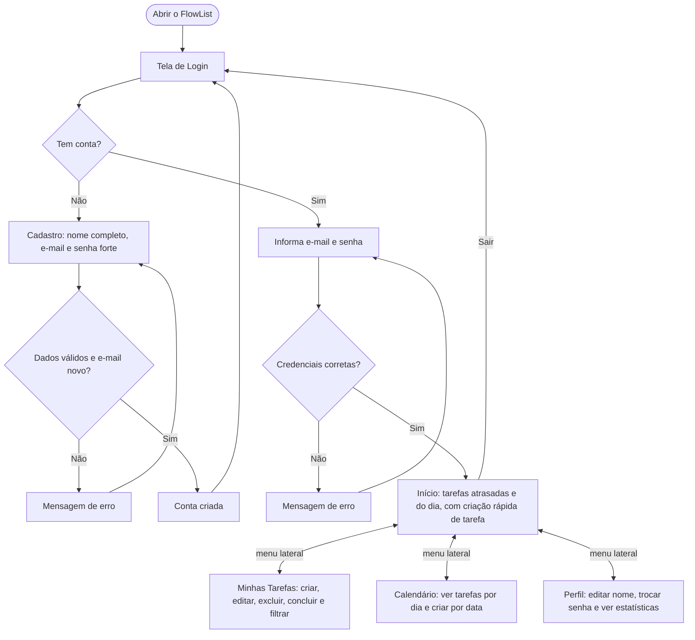
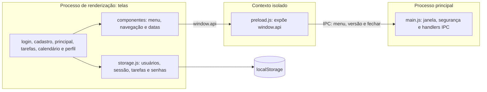

# FlowList

> Organize seu dia, uma tarefa por vez.

**FlowList** é um aplicativo desktop para gerenciar tarefas, prazos e prioridades. Cada pessoa cria a sua conta, faz login e passa a ter uma lista de tarefas própria, um calendário mensal e um perfil com estatísticas de produtividade. Tudo funciona offline, direto no computador.

Projeto acadêmico desenvolvido com **Electron**, HTML, CSS, JavaScript e Bootstrap 5.

## Funcionalidades

- **Cadastro e login** com validação dos campos e botão de mostrar/ocultar senha
- **Início** com as tarefas **atrasadas** e as **do dia**, e criação rápida de tarefa (título, prazo e prioridade)
- **Minhas Tarefas** com criação, edição, exclusão e conclusão, e filtros *Todas*, *Pendentes*, *Atrasadas* e *Concluídas*
- **Calendário** mensal com painel do dia e criação/edição de tarefas por data
- **Perfil** com iniciais do usuário, alteração de nome, alteração de senha e estatísticas (total, pendentes, concluídas, taxa de conclusão e pendentes por prioridade)
- **Menu lateral compartilhado** entre as telas, com destaque da página atual e botão **Sair**
- Dados separados por usuário: cada conta enxerga apenas as próprias tarefas

## Como usar

1. Ao abrir o app, você cai na tela de **Login**. Se ainda não tem conta, vá para o **Cadastro**.
2. Depois do cadastro, o app leva você de volta ao **Login**.
3. Com o login feito, a tela **Início** é aberta. Se não houver sessão ativa, qualquer tela interna redireciona para o login.
4. Pelo menu lateral, navegue entre **Início**, **Minhas Tarefas**, **Calendário** e **Perfil**.

### Fluxo do usuário



## Tecnologias

| Tecnologia | Uso |
|---|---|
| [Electron](https://www.electronjs.org/) | Aplicativo desktop (processo principal, preload e janelas) |
| HTML, CSS e JavaScript | Telas e lógica do app |
| [Bootstrap 5](https://getbootstrap.com/) e Bootstrap Icons | Layout e ícones |
| [Inter](https://fontsource.org/fonts/inter) (Fontsource) | Tipografia |
| `localStorage` + Web Crypto API | Persistência local e hash de senhas |

## Instalação e execução

Pré-requisitos: [Node.js](https://nodejs.org/) (versão LTS) e npm.

```bash
# 1. Clone o repositório
git clone https://github.com/Karollayne802/desktop-tutorial.git
cd desktop-tutorial

# 2. Instale as dependências
npm install

# 3. Inicie o aplicativo
npm start
```

## Estrutura do projeto

Cada tela tem a sua própria pasta, com HTML, CSS e JS juntos.

```
desktop-tutorial/
├── main.js                 # Processo principal do Electron: janela, segurança e handlers IPC
├── package.json
└── src/
    ├── preload/
    │   └── preload.js      # Ponte segura (contextBridge) entre o app e o processo principal
    ├── storage.js          # Camada de dados: usuários, sessão, tarefas e senhas
    ├── login/              # Tela de login
    ├── cadastro/           # Tela de cadastro
    ├── principal/          # Tela inicial (atrasadas e do dia)
    ├── tarefas/            # Minhas Tarefas
    ├── calendario/         # Calendário
    ├── perfil/             # Perfil e estatísticas
    ├── componentes/        # Menu lateral, navegação, datas, minicalendário e estilos comuns
    └── imagens/            # Ícone do aplicativo
```

## Arquitetura e segurança



O app segue as boas práticas de segurança do Electron:

- `contextIsolation: true`, `nodeIntegration: false` e `sandbox: true`: as telas não têm acesso direto ao Node.js.
- O **preload** expõe apenas três funções em `window.api`: obter o HTML do menu, obter a versão do app e fechar o app.
- O **processo principal** valida a origem de cada chamada IPC e só aceita chamadas vindas das seis telas do app.
- Janelas extras (`window.open`) e navegação para fora das telas do app são bloqueadas.

### Armazenamento e senhas

Os dados de contas e tarefas ficam no `localStorage` do aplicativo, acessados pelo `src/storage.js`. As senhas novas são guardadas com **PBKDF2-SHA-256**, salt aleatório e 310.000 iterações. Contas criadas com a versão anterior (SHA-256 simples) são atualizadas para o formato novo no primeiro login bem-sucedido.

> Como o armazenamento é local, esta é uma proteção pensada para um aplicativo didático, e não um sistema de autenticação para dados sensíveis: quem tiver acesso ao computador e ao perfil local do app ainda pode inspecionar ou alterar os dados.

## Autores

- Arthur Lima
- Karollayne Correia

## Licença

Distribuído sob a licença ISC.
